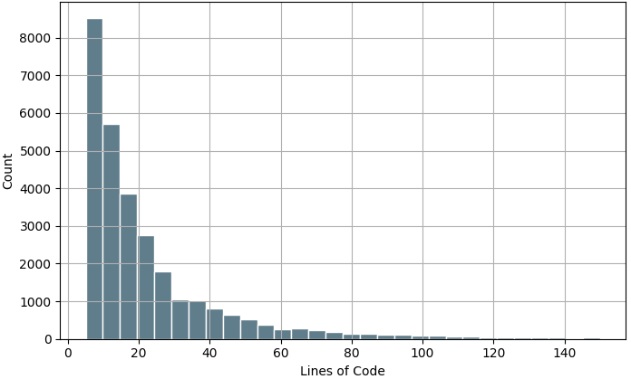
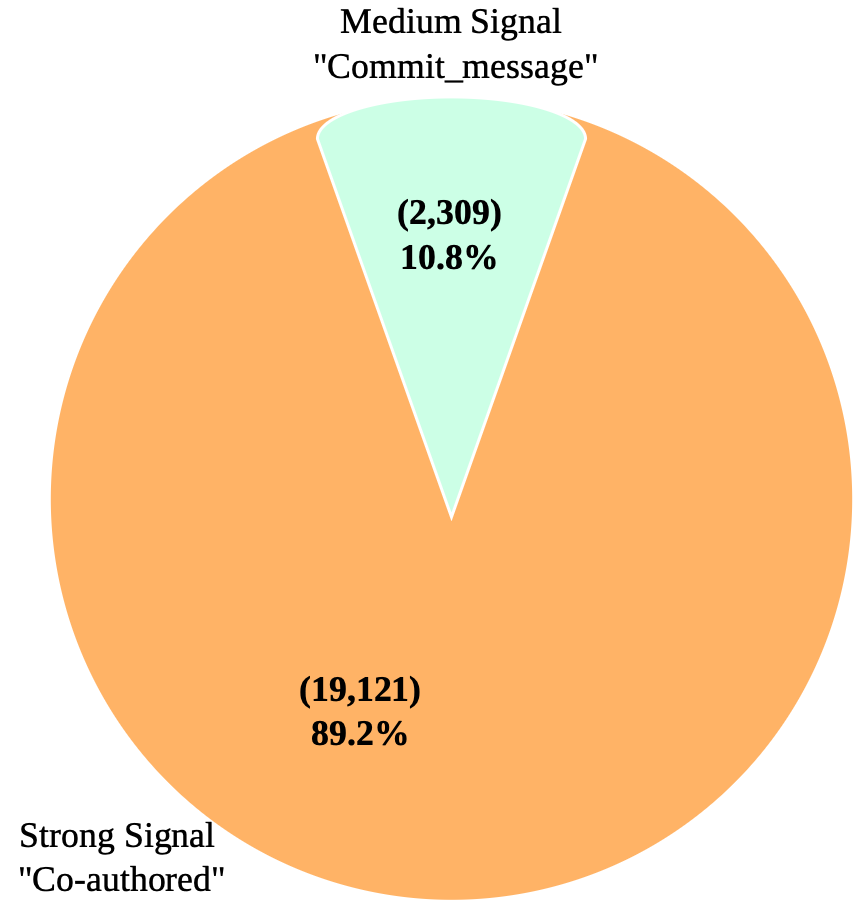

## Figure 1
### Distribution of Function Lengths (Lines of Code)

  

The histogram shows the distribution of functions in the LLMVul dataset across different lines-of-code (LoC) ranges, with function lengths ranging from 5 to 150 lines.

## Figure 2
### Strength of AI-Attributed  Signals

  

This chart shows how the code was attributed to AI involvement, using the type of evidence found in the commit history:

| Signal Strength | Evidence | Count | Percentage |
|---|---|---:|---:|
| Strong | `Co-authored` (an explicit co-author attribution in the commit) | 19,121 | 89.2% |
| Medium | `Commit_message` (the commit message mentions LLM assistance) | 2,309 | 10.8% |

**Note:** A strong signal is an explicit, structured attribution, so it is a more reliable indicator of AI involvement. A medium signal relies on free-text mentions in commit messages, so it is less certain. Almost 90% of the labeled samples rest on strong evidence.